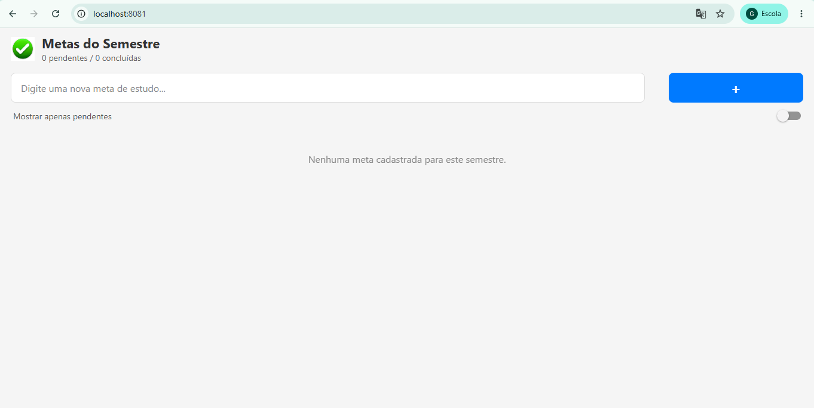

# App MetasSemestre 🎯

Aplicativo em React Native/Expo desenvolvido para gerenciamento de metas acadêmicas do semestre, utilizando hooks (`useState`, `useEffect`), componentização, feedback visual nativo e persistência local via `AsyncStorage`.

---

## 📌 Explicação Técnica dos `useEffect` (Persistência)

A persistência de dados foi estruturada utilizando dois hooks `useEffect` distintos no arquivo `App.tsx` para evitar sobreecritas acidentais:

1. **`useEffect` de Carga Inicial (Leitura):**
   * **Localização:** `App.tsx` (linhas 18 a 32).
   * **Funcionamento:** Executado uma única vez na montagem do componente (array de dependências vazio `[]`). Ele busca a chave `@metas_semestre` no `AsyncStorage`. Caso existam dados gravados, realiza o `JSON.parse()` para converter a string de volta em array e atualiza o estado `metas`. Ao finalizar, define a flag `isCarregado = true`.

2. **`useEffect` de Salvamento (Escrita):**
   * **Localização:** `App.tsx` (linhas 34 a 45).
   * **Funcionamento:** Possui como dependência o estado `[metas, isCarregado]`. Sempre que a lista de metas sofre alteração (adição, remoção ou marcação de concluída), ele converte a lista em texto usando `JSON.stringify()` e grava no `AsyncStorage.setItem()`. A trava `if (!isCarregado) return;` impede que o app salve um array vazio antes de concluir a leitura inicial.

---

## 📸 Evidências do Funcionamento (Screenshots)

> *Substitua os links abaixo pelos caminhos das imagens capturadas do seu celular (ex: `./assets/screenshots/vazia.png`).*

| 1. Lista Vazia (Inicial) | 2. Com Itens Cadastrados | 3. Dados Mantidos Após Reabrir App |
| :---: | :---: | :---: |
|  |  |  |

---

## 🚀 Como Executar o Projeto

1. Instale as dependências:
   ```bash
   npm install